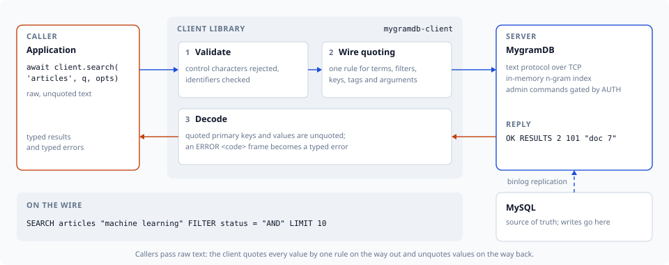
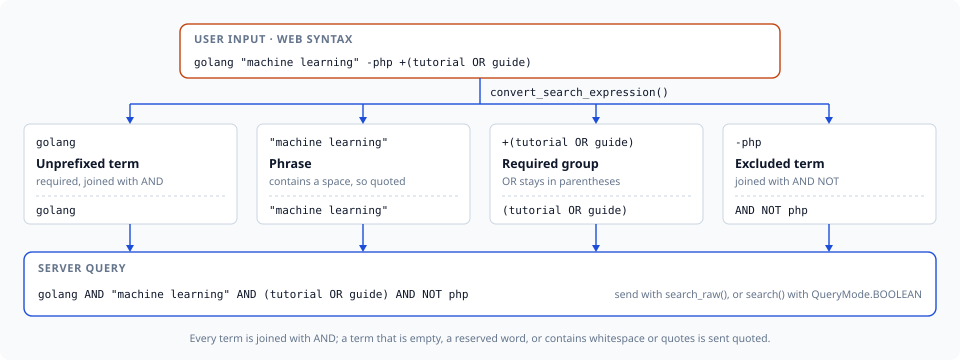

# python-mygramdb-client

[](https://github.com/libraz/python-mygramdb-client/actions)
[](https://pypi.org/project/mygramdb-client/)
[](https://codecov.io/gh/libraz/python-mygramdb-client)
[](https://github.com/libraz/python-mygramdb-client/blob/main/LICENSE)
[](https://www.python.org/)
[](https://github.com/libraz/python-mygramdb-client)

Python client library for [MygramDB](https://github.com/libraz/mygram-db/) — a high-performance in-memory full-text search engine with MySQL replication support.

**Server compatibility:** MygramDB 1.6 or later, with the protocol implemented through 1.10.2. A server rejects options it predates, and an older server's `ERROR` frames carry no numeric code; the [API reference](https://github.com/libraz/python-mygramdb-client/blob/main/docs/en/api-reference.md) marks each option that needs a newer server.



## Overview

MygramDB answers full-text queries from memory instead of an on-disk MySQL FULLTEXT index. How much that gains depends on the query and the dataset; the [published benchmarks](https://mygramdb.libraz.net/benchmarks) give the numbers together with the conditions they were measured under. This client communicates via MygramDB's TCP text protocol (memcached-style) with zero external dependencies.

| | MySQL FULLTEXT | MygramDB |
|---|---|---|
| **Search Speed** | Baseline | [Measured](https://mygramdb.libraz.net/benchmarks) |
| **Storage** | On-disk | In-memory |
| **Replication** | — | MySQL binlog |
| **Protocol** | MySQL | TCP (memcached-style) |

### Features

- **Zero Dependencies** — Standard library only
- **Async/Await API** — Modern asyncio-based interface with context manager support
- **Connection Pooling** — Built-in `MygramPool` for high-throughput workloads, with per-command retry, circuit breaker, and observability hooks
- **Resilient Transport** — Auto-reconnect (with re-authentication), one total command deadline, response frame cap, and TCP keepalive
- **Typed Errors** — Numeric server error codes decoded into specific exceptions, so retry decisions never depend on message text
- **IPv4 and IPv6** — Connects to IPv6 literals (`host='::1'`) and to hostnames that resolve only to an AAAA record
- **Search Expression Parser** — Web-style search syntax (+required, -excluded, "phrase", OR, grouping)
- **Full Protocol Support** — All MygramDB commands (SEARCH, COUNT, GET, INFO, CACHE, DUMP, OPTIMIZE, etc.)
- **Type Safety** — Full type hints with dataclasses, shipped with a PEP 561 `py.typed` marker
- **Input Validation** — Built-in protection against control character injection

## Installation

```bash
pip install mygramdb-client
```

### From source

```bash
git clone https://github.com/libraz/python-mygramdb-client.git
cd python-mygramdb-client
rye sync
```

## Quick Start

```python
import asyncio
from mygramdb_client import MygramClient, ClientConfig, SearchOptions

async def main():
    async with MygramClient(ClientConfig(host='localhost', port=11016)) as client:
        # Search
        results = await client.search('articles', 'hello', SearchOptions(limit=100))
        print(f"Found {results.total_count} results")

        # Count
        count = await client.count('articles', 'technology')
        print(f"Count: {count.count}")

        # Get document by ID
        doc = await client.get('articles', '12345')
        print(f"Doc: {doc.primary_key} {doc.fields}")

asyncio.run(main())
```

## Connection Pooling

For hundreds of requests per second, use `MygramPool` instead of a single
connection. It multiplexes concurrent requests over a bounded set of
connections and layers on retry, a circuit breaker, and event hooks.

```python
from mygramdb_client import (
    MygramPool, PoolConfig, ClientConfig,
    RetryPolicy, CircuitBreakerConfig,
)

pool_config = PoolConfig(
    min_connections=4,
    max_connections=32,
    acquire_timeout=2.0,
    retry_policy=RetryPolicy(max_attempts=3),
    circuit_breaker=CircuitBreakerConfig(failure_threshold=5, reset_timeout=10.0),
)

async with MygramPool(ClientConfig(host='localhost'), pool_config) as pool:
    # Delegation API: acquire, run, release — with retry + breaker applied
    result = await pool.search('articles', 'hello')

    # Or check out a connection explicitly
    async with pool.acquire() as client:
        await client.count('articles', 'python')

    print(pool.stats())  # PoolStats snapshot
```

See [Advanced Usage](https://github.com/libraz/python-mygramdb-client/blob/main/docs/en/advanced-usage.md)
for timeouts, auto-reconnect, and observability details.

## Search Expressions

`convert_search_expression()` turns web-style input into a server boolean
query: unprefixed terms and `+` terms are joined with `AND`, `-` terms become
`AND NOT`, and an OR chain stays in parentheses.



`search()` sends its query as literal text, so a boolean expression goes through
`search_raw()`, or through `search()` with `QueryMode.BOOLEAN` when it also
needs filters, sorting, fuzzy matching or highlighting:

```python
from mygramdb_client import (
    convert_search_expression, HighlightOptions, QueryMode,
    SearchOptions, SearchRawOptions,
)

raw = convert_search_expression('golang "machine learning" -php +(tutorial OR guide)')
# 'golang AND "machine learning" AND (tutorial OR guide) AND NOT php'

res = await client.search_raw('articles', raw, SearchRawOptions(limit=50))

res = await client.search('articles', raw, SearchOptions(
    query_mode=QueryMode.BOOLEAN,
    filters={'lang': 'en'},
    sort_column='_score',
    highlight=HighlightOptions(),
))
```

In the default literal mode, plain user text keeps matching as a phrase. For
input without OR or grouping, `simplify_search_expression()` splits it into a
main term plus AND/NOT terms for `search()`; it raises `ValueError` on OR or
grouping, so check with `has_complex_expression()` first when the input may
contain either:

```python
from mygramdb_client import (
    convert_search_expression, has_complex_expression,
    parse_search_expression, simplify_search_expression,
)

if has_complex_expression(parse_search_expression(user_input)):
    results = await client.search_raw('articles', convert_search_expression(user_input))
else:
    expr = simplify_search_expression(user_input)
    results = await client.search('articles', expr.main_term, SearchOptions(
        and_terms=expr.and_terms,
        not_terms=expr.not_terms,
        limit=100,
        filters={'status': 'published', 'lang': 'en'},
        sort_column='created_at',
        sort_desc=True,
    ))
```

## Search Features

```python
from mygramdb_client import HighlightOptions, FacetOptions, SearchOptions

# BM25 relevance scoring
result = await client.search('articles', 'python',
    SearchOptions(sort_column='_score', sort_desc=True))

# Fuzzy search (Levenshtein distance 1 or 2)
result = await client.search('articles', 'helo',
    SearchOptions(fuzzy=1))

# Highlighted snippets
result = await client.search('articles', 'python',
    SearchOptions(highlight=HighlightOptions(
        open_tag='<mark>', close_tag='</mark>',
        snippet_len=150, max_fragments=3,
    )))
for r in result.results:
    print(r.primary_key, r.snippet)
```

### Comparison Filters

`filters` covers equality. For range and inequality predicates, pass
`filter_conditions`:

```python
from mygramdb_client import FilterCondition, FilterOp

result = await client.search('articles', 'python', SearchOptions(
    filters={'lang': 'en'},                               # FILTER lang = en
    filter_conditions=[
        FilterCondition('views', '100', FilterOp.GTE),    # FILTER views >= 100
        FilterCondition('status', 'draft', FilterOp.NE),  # FILTER status != draft
    ],
))
```

### Facets

`facet()` aggregates distinct filter-column values with document counts,
optionally scoped to a query. It takes a `limit` and `offset`, and the response
reports how many distinct values exist in total. A value that starts with `#`
is kept as data.

```python
facets = await client.facet('articles', 'category',
    FacetOptions(query='python', limit=10))
for v in facets.results:
    print(f'{v.value}: {v.count}')

page = await client.facet('articles', 'category',
    FacetOptions(limit=20, offset=40))
print(f'{len(page.results)} of {page.total_count} categories')
```

### Multi-database Tables

A server can index tables from more than one database. Reference a table as
`database.table`; bare names work on single-database servers.

```python
from mygramdb_client import qualify_table_identity, parse_table_identity

await client.search('app_db.articles', 'hello')

qualify_table_identity('articles', 'app_db')  # 'app_db.articles'
parse_table_identity('app_db.articles')       # ('app_db', 'articles')
```

## Wire Quoting

Search text, AND/NOT terms, filter values and command arguments (`SET`,
`SHOW VARIABLES LIKE`, `DUMP`) all go through one quoting decision: quoted
when empty, a reserved clause keyword (`AND`, `OR`, `NOT`, `FILTER`, `SORT`,
`LIMIT`, `OFFSET`, `HIGHLIGHT`, `FUZZY`, `FACET`, `ORDER`, matched
case-insensitively), or containing ASCII/Unicode whitespace (including the
full-width space U+3000 and no-break space U+00A0), a control character, `"`,
`'`, `\`, `(` or `)`. Callers pass raw text; the client quotes it
automatically:

```python
# The full-width space stays inside one term.
await client.search('articles', '機械学習　チュートリアル')

# A filter value equal to a reserved keyword still matches literally.
await client.search('articles', 'q', SearchOptions(filters={'status': 'AND'}))
```

A search result's primary key containing whitespace is decoded back from its
quoted wire form.

## Authentication and Error Codes

### Administrative Authentication

A server whose TCP listener is not loopback-only requires an admin token for
administrative commands. Set it once on the config and the client
authenticates on connect and on every transparent reconnect:

```python
config = ClientConfig(host='localhost', admin_token='...', auto_reconnect=True)
async with MygramClient(config) as client:
    await client.optimize('articles')   # administrative command, already authed
```

The TCP transport does not encrypt the token — keep that listener on a trusted
network or behind a terminating proxy.

### Typed Error Codes

Every `ERROR` frame carries a numeric code, so retry and failover decisions
branch on the code instead of matching message text:

```python
from mygramdb_client import ErrorCode, ServerError, ServerNotReadyError

try:
    await client.search('articles', 'python')
except ServerNotReadyError:
    ...                      # still loading; retrying may succeed
except ServerError as exc:
    if exc.error_code == ErrorCode.TABLE_NOT_FOUND:
        ...                  # retrying cannot help
```

`RetryPolicy` uses this by default: `ServerNotReadyError` and `ServerBusyError`
are retried, other server rejections are not.

### Readiness

`INFO` reports readiness, so a TCP-only deployment can gate traffic without
polling the HTTP health endpoint:

```python
info = await client.info()
if not (info.data_initialized and info.ready):
    ...
```

## Server Administration

### Replication Lag

`get_replication_status()` reports `seconds_since_last_applied`, stamped where
the replication position advances, so it measures progress rather than
connectivity. It is an administrative command, so a server with a token
configured needs `admin_token` to answer it:

```python
status = await client.get_replication_status()
if (status.seconds_since_last_applied or 0) > 60:
    print(f'replication is {status.seconds_since_last_applied}s behind', status.last_error)
```

### Runtime Variables and On-demand Sync

```python
await client.set_variable('logging.level', 'info')
print(await client.show_variables('logging%'))

await client.sync('app_db.articles')
print(await client.sync_status())
await client.sync_stop('app_db.articles')
```

## Type Hints

The package ships a PEP 561 `py.typed` marker, so type checkers (mypy, pyright)
use its inline annotations directly — no stub package needed. Full type
definitions are included:

```python
from mygramdb_client import (
    ClientConfig,
    SearchResponse,
    CountResponse,
    Document,
    ServerInfo,
    SearchOptions,
    DumpStatus,
    CacheStats,
)
```

## Documentation

- [Getting Started](https://github.com/libraz/python-mygramdb-client/blob/main/docs/en/getting-started.md) — install, configuration, and error handling
- [Search Expressions](https://github.com/libraz/python-mygramdb-client/blob/main/docs/en/search-expression.md) — parse and convert web-style search input
- [API Reference](https://github.com/libraz/python-mygramdb-client/blob/main/docs/en/api-reference.md) — every method, option, and type
- [Advanced Usage](https://github.com/libraz/python-mygramdb-client/blob/main/docs/en/advanced-usage.md) — connection pooling, resilience, authentication, and error codes

## Development

```bash
rye sync              # Install dependencies
rye run pytest        # Run tests
rye run pytest -v     # Run tests (verbose)
rye run flake8 src tests  # Lint
```

## License

[MIT](https://github.com/libraz/python-mygramdb-client/blob/main/LICENSE)
