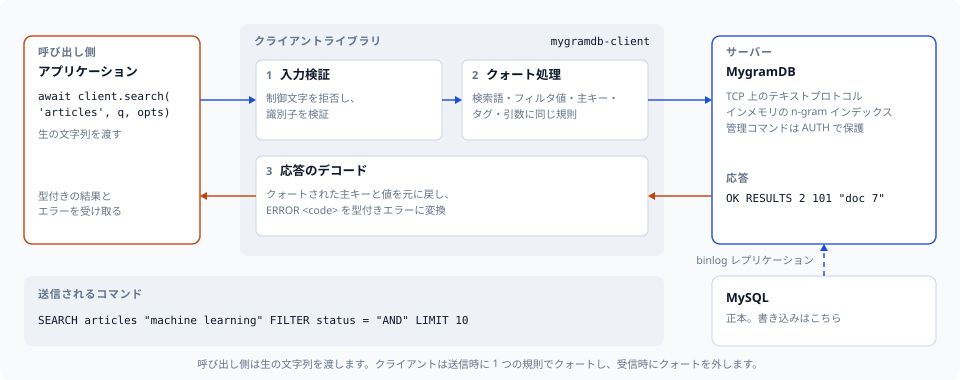
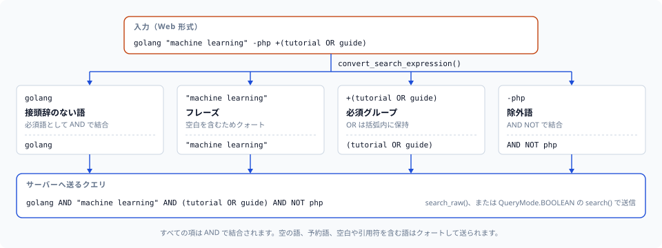

# python-mygramdb-client

[](https://github.com/libraz/python-mygramdb-client/actions)
[](https://pypi.org/project/mygramdb-client/)
[](https://codecov.io/gh/libraz/python-mygramdb-client)
[](LICENSE)
[](https://www.python.org/)
[](https://github.com/libraz/python-mygramdb-client)

[MygramDB](https://github.com/libraz/mygram-db/) 用の Python クライアントライブラリです。MygramDB は MySQL レプリケーションに対応した高性能なインメモリ全文検索エンジンです。

**対応サーバー:** MygramDB 1.6 以降に対応し、1.12.0 までのプロトコルを実装しています。サーバーは自身より新しいオプションを拒否し、古いサーバーの `ERROR` には数値コードが付きません。新しいサーバーを必要とするオプションは [API リファレンス](docs/ja/api-reference.md)に明記しています。



## 概要

MygramDB は、ディスク上の MySQL FULLTEXT インデックスではなくメモリから全文検索に応答します。どれだけ速くなるかはクエリとデータセット次第で、実測値と測定条件は[公開ベンチマーク](https://mygramdb.libraz.net/ja/benchmarks)に載せています。このクライアントは MygramDB の TCP テキストプロトコル（memcached スタイル）で通信し、外部依存はありません。

| | MySQL FULLTEXT | MygramDB |
|---|---|---|
| **検索速度** | ベースライン | [実測値](https://mygramdb.libraz.net/ja/benchmarks) |
| **ストレージ** | ディスク | インメモリ |
| **レプリケーション** | — | MySQL binlog |
| **プロトコル** | MySQL | TCP（memcached スタイル） |

### 特徴

- **外部依存ゼロ** — 標準ライブラリのみ
- **Async/Await API** — コンテキストマネージャに対応した asyncio ベースのインターフェース
- **コネクションプール** — 高スループット用途向けの組み込み `MygramPool`（コマンド単位のリトライ、サーキットブレーカー、観測フック付き）
- **堅牢なトランスポート** — 自動再接続（再認証付き）、コマンド全体で 1 つのデッドライン、レスポンスフレームの上限、TCP キープアライブ
- **型付きエラー** — サーバーの数値エラーコードを個別の例外にデコードするため、リトライ判定がメッセージ文字列に依存しません
- **IPv4 と IPv6** — IPv6 リテラル（`host='::1'`）や AAAA レコードにのみ解決されるホスト名にも接続します
- **検索式パーサー** — Web スタイルの検索構文（+必須、-除外、"フレーズ"、OR、グループ化）
- **完全なプロトコルサポート** — すべての MygramDB コマンド（SEARCH、COUNT、GET、INFO、CACHE、DUMP、OPTIMIZE など）
- **型安全性** — dataclass による完全な型ヒント。PEP 561 の `py.typed` マーカーを同梱
- **入力バリデーション** — 制御文字インジェクションに対する組み込み保護

## インストール

```bash
pip install mygramdb-client
```

### ソースから

```bash
git clone https://github.com/libraz/python-mygramdb-client.git
cd python-mygramdb-client
rye sync
```

## クイックスタート

```python
import asyncio
from mygramdb_client import MygramClient, ClientConfig, SearchOptions

async def main():
    async with MygramClient(ClientConfig(host='localhost', port=11016)) as client:
        # 検索
        results = await client.search('articles', 'hello', SearchOptions(limit=100))
        print(f"{results.total_count} 件ヒット")

        # 件数取得
        count = await client.count('articles', 'technology')
        print(f"件数: {count.count}")

        # ID でドキュメントを取得
        doc = await client.get('articles', '12345')
        print(f"ドキュメント: {doc.primary_key} {doc.fields}")

asyncio.run(main())
```

## コネクションプーリング

毎秒数百リクエスト規模では、単一接続の代わりに `MygramPool` を使います。上限付きの接続セットに並行リクエストを多重化し、リトライ、サーキットブレーカー、イベントフックを重ねて適用します。

```python
from mygramdb_client import (
    MygramPool, PoolConfig, ClientConfig,
    RetryPolicy, CircuitBreakerConfig,
)

pool_config = PoolConfig(
    min_connections=4,
    max_connections=32,
    acquire_timeout=2.0,
    retry_policy=RetryPolicy(max_attempts=3),
    circuit_breaker=CircuitBreakerConfig(failure_threshold=5, reset_timeout=10.0),
)

async with MygramPool(ClientConfig(host='localhost'), pool_config) as pool:
    # 委譲 API: 取得・実行・返却（リトライとブレーカーを適用）
    result = await pool.search('articles', 'hello')

    # 明示的に接続を借りることもできる
    async with pool.acquire() as client:
        await client.count('articles', 'python')

    print(pool.stats())  # PoolStats のスナップショット
```

タイムアウト、自動再接続、観測の詳細は[高度な使い方](docs/ja/advanced-usage.md)を参照してください。

## 検索式

`convert_search_expression()` は Web 形式の入力をサーバーのブールクエリに変換します。接頭辞のない語と `+` の語は `AND` で結合され、`-` の語は `AND NOT` になり、OR の連なりは括弧で囲まれたまま残ります。



`search()` はクエリをリテラルテキストとして送るため、ブール式は `search_raw()` で送ります。フィルタ、ソート、あいまい検索、ハイライトも組み合わせる場合は、`search()` に `QueryMode.BOOLEAN` を渡します。

```python
from mygramdb_client import (
    convert_search_expression, HighlightOptions, QueryMode,
    SearchOptions, SearchRawOptions,
)

raw = convert_search_expression('golang "machine learning" -php +(tutorial OR guide)')
# 'golang AND "machine learning" AND (tutorial OR guide) AND NOT php'

res = await client.search_raw('articles', raw, SearchRawOptions(limit=50))

res = await client.search('articles', raw, SearchOptions(
    query_mode=QueryMode.BOOLEAN,
    filters={'lang': 'ja'},
    sort_column='_score',
    highlight=HighlightOptions(),
))
```

既定のリテラルモードでは、通常のユーザー入力はフレーズとしてマッチします。OR やグループ化を含まない入力は、`simplify_search_expression()` で主項と AND/NOT の項に分けて `search()` に渡せます。この関数は OR やグループ化を含む式では `ValueError` を送出するため、どちらかを含みうる入力は先に `has_complex_expression()` で判定します。

```python
from mygramdb_client import (
    convert_search_expression, has_complex_expression,
    parse_search_expression, simplify_search_expression,
)

if has_complex_expression(parse_search_expression(user_input)):
    results = await client.search_raw('articles', convert_search_expression(user_input))
else:
    expr = simplify_search_expression(user_input)
    results = await client.search('articles', expr.main_term, SearchOptions(
        and_terms=expr.and_terms,
        not_terms=expr.not_terms,
        limit=100,
        filters={'status': 'published', 'lang': 'ja'},
        sort_column='created_at',
        sort_desc=True,
    ))
```

## 検索機能

```python
from mygramdb_client import HighlightOptions, FacetOptions, SearchOptions

# BM25 関連度スコアリング
result = await client.search('articles', 'python',
    SearchOptions(sort_column='_score', sort_desc=True))

# あいまい検索（レーベンシュタイン距離 1 または 2）
result = await client.search('articles', 'helo',
    SearchOptions(fuzzy=1))

# ハイライト付きスニペット
result = await client.search('articles', 'python',
    SearchOptions(highlight=HighlightOptions(
        open_tag='<mark>', close_tag='</mark>',
        snippet_len=150, max_fragments=3,
    )))
for r in result.results:
    print(r.primary_key, r.snippet)
```

### 比較フィルタ

`filters` は等価比較を扱います。範囲や不等号の条件は `filter_conditions` で渡します。

```python
from mygramdb_client import FilterCondition, FilterOp

result = await client.search('articles', 'python', SearchOptions(
    filters={'lang': 'ja'},                               # FILTER lang = ja
    filter_conditions=[
        FilterCondition('views', '100', FilterOp.GTE),    # FILTER views >= 100
        FilterCondition('status', 'draft', FilterOp.NE),  # FILTER status != draft
    ],
))
```

### ファセット

`facet()` はフィルタ列の値ごとの件数を集計し、クエリで範囲を絞り込むこともできます。`limit` と `offset` を受け取り、レスポンスは値の種類の総数を返します。`#` で始まる値もデータとしてそのまま残ります。

```python
facets = await client.facet('articles', 'category',
    FacetOptions(query='python', limit=10))
for v in facets.results:
    print(f'{v.value}: {v.count}')

page = await client.facet('articles', 'category',
    FacetOptions(limit=20, offset=40))
print(f'{page.total_count} カテゴリ中 {len(page.results)} 件')
```

### マルチデータベースのテーブル

サーバーは複数のデータベースのテーブルをインデックスできます。テーブルは `database.table` 形式で参照します。単一データベースのサーバーでは、データベース名を付けないテーブル名も使えます。

```python
from mygramdb_client import qualify_table_identity, parse_table_identity

await client.search('app_db.articles', 'hello')

qualify_table_identity('articles', 'app_db')  # 'app_db.articles'
parse_table_identity('app_db.articles')       # ('app_db', 'articles')
```

## ワイヤー上のクォート

検索テキスト、AND/NOT の項、フィルタ値、コマンド引数（`SET`、`SHOW VARIABLES LIKE`、`DUMP`）は、すべて同じクォート判定を通ります。次のいずれかに当てはまる値はクォートされます。

- 空文字列
- 予約済みの句キーワード（`AND`・`OR`・`NOT`・`FILTER`・`SORT`・`LIMIT`・`OFFSET`・`HIGHLIGHT`・`FUZZY`・`FACET`・`ORDER`。大文字小文字を区別せずに照合します）
- ASCII または Unicode の空白を含む値（全角スペース U+3000 やノーブレークスペース U+00A0 も対象です）
- 制御文字、`"`、`'`、`\`、`(`、`)` を含む値

呼び出し側は生のテキストを渡し、クライアントが自動でクォートします。

```python
# 全角スペースは 1 つの項の中に残ります。
await client.search('articles', '機械学習　チュートリアル')

# 予約キーワードと一致するフィルタ値もリテラルとして一致します。
await client.search('articles', 'q', SearchOptions(filters={'status': 'AND'}))
```

検索結果のプライマリキーが空白を含む場合は、クォートされたワイヤー形式から元の値にデコードされます。

## 認証とエラーコード

### 管理コマンドの認証

TCP リスナーがループバック限定でないサーバーは、管理コマンドに管理トークンを要求します。config に一度設定すれば、クライアントは接続時と透過的な再接続のたびに認証します。

```python
config = ClientConfig(host='localhost', admin_token='...', auto_reconnect=True)
async with MygramClient(config) as client:
    await client.optimize('articles')   # 管理コマンド。認証済み
```

TCP トランスポートはトークンを暗号化しません。リスナーは信頼できるネットワーク内か、TLS を終端するプロキシの背後に置いてください。

### 型付きエラーコード

すべての `ERROR` フレームは数値コードを持つため、リトライやフェイルオーバーの判定はメッセージ文字列ではなくコードで分岐できます。

```python
from mygramdb_client import ErrorCode, ServerError, ServerNotReadyError

try:
    await client.search('articles', 'python')
except ServerNotReadyError:
    ...                      # ロード中。リトライで成功する可能性あり
except ServerError as exc:
    if exc.error_code == ErrorCode.TABLE_NOT_FOUND:
        ...                  # リトライしても解決しない
```

`RetryPolicy` は既定でこのコードを使います。`ServerNotReadyError` と `ServerBusyError` はリトライし、それ以外のサーバー側の拒否はリトライしません。

### レディネス

`INFO` がレディネスを返すため、TCP のみの構成でも HTTP のヘルスエンドポイントをポーリングせずにトラフィックを制御できます。

```python
info = await client.info()
if not (info.data_initialized and info.ready):
    ...
```

## サーバー管理

### レプリケーション遅延

`get_replication_status()` は `seconds_since_last_applied` を返します。この値はレプリケーション位置が進んだ時点で記録されるため、疎通ではなく実際の進捗を表します。`get_replication_status()` は管理コマンドなので、トークンを設定したサーバーから取得するには `admin_token` が必要です。

```python
status = await client.get_replication_status()
if (status.seconds_since_last_applied or 0) > 60:
    print(f'レプリケーションが {status.seconds_since_last_applied} 秒遅延しています', status.last_error)
```

### ランタイム変数とオンデマンド同期

```python
await client.set_variable('logging.level', 'info')
print(await client.show_variables('logging%'))

await client.sync('app_db.articles')
print(await client.sync_status())
await client.sync_stop('app_db.articles')
```

## 型ヒント

PEP 561 の `py.typed` マーカーを同梱しているため、型チェッカー（mypy、pyright）はインラインの型注釈をそのまま使います。スタブパッケージは不要です。

```python
from mygramdb_client import (
    ClientConfig,
    SearchResponse,
    CountResponse,
    Document,
    ServerInfo,
    SearchOptions,
    DumpStatus,
    CacheStats,
)
```

## ドキュメント

- [はじめに](docs/ja/getting-started.md) — インストール、設定、エラー処理
- [検索式](docs/ja/search-expression.md) — Web 形式の検索入力のパースと変換
- [API リファレンス](docs/ja/api-reference.md) — すべてのメソッド、オプション、型
- [高度な使い方](docs/ja/advanced-usage.md) — コネクションプーリング、レジリエンス、認証、エラーコード

## 開発

```bash
rye sync              # 依存関係をインストール
rye run pytest        # テストを実行
rye run pytest -v     # テストを実行（詳細表示）
rye run flake8 src tests  # リント
```

## ライセンス

[MIT](LICENSE)
