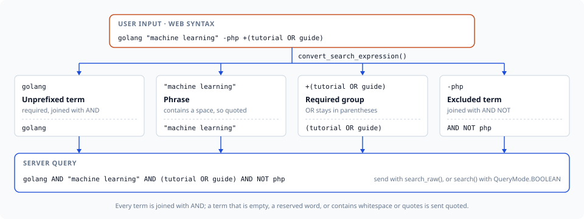

# Search Expression

This guide covers the web-style search expression syntax supported by mygramdb-client. Mirrors MygramDB's own C++ SDK parser (`src/client/search_expression.cpp`), so an expression converts to the same query meaning on every client.

## Overview

The search expression parser converts web-style search expressions into MygramDB query format. This allows users to use familiar search syntax similar to Google or other search engines.

## Syntax

| Syntax | Description | Example |
|--------|-------------|---------|
| `term` | Required term, implicit AND (every unprefixed term is required) | `python` |
| `+term` | Required term (must appear) | `+python` |
| `-term` | Excluded term (must not appear) | `-deprecated` |
| `"phrase"` | Quoted phrase (exact match) | `"machine learning"` |
| `OR` | Logical OR between terms; implicit AND binds tighter | `python OR ruby` |
| `(expr)` | Grouping | `+(tutorial OR guide)` |

`OR` is an operator only as a whole token: delimited by whitespace, a parenthesis or a double quote on both sides, and not directly after a `+`/`-`. Terms that merely begin with it (`OR-tools`, `OR回路`) stay ordinary terms.

An expression with a top-level `OR` is one group, because implicit AND binds tighter than `OR`: `a OR b c` converts to `(a OR b c)`, which is also what `(a OR b c)` means, so a bare expression and its parenthesized form are equivalent. Inside a group, `-` negates only the next operand and a nested group counts as one operand: `(a -(b c))` converts to `((a NOT (b c)))`.

A term that collides with a clause keyword (`AND`, `OR`, `NOT`, `FILTER`, `SORT`, `LIMIT`, `OFFSET`, `HIGHLIGHT`, `FUZZY`, `FACET`, `ORDER`) is quoted automatically wherever the parser emits it onto the wire, so it matches as literal text instead of being read as an operator: `convert_search_expression('golang not')` produces `golang AND "not"`. A `+`/`-` inside a word (`COVID-19`, `e-mail`, `C++`) is left alone; only a `+`/`-` at a token boundary is an operator.



```python
convert_search_expression('golang "machine learning" -php +(tutorial OR guide)')
# 'golang AND "machine learning" AND (tutorial OR guide) AND NOT php'
```

## Examples

### Basic Search

```python
from mygramdb_client import simplify_search_expression

# Single term
expr = simplify_search_expression('python')
# main_term='python', and_terms=[], not_terms=[]

# Multiple terms (implicit AND) -- every unprefixed term is required
expr = simplify_search_expression('python tutorial')
# main_term='python', and_terms=['tutorial'], not_terms=[]
```

### Required Terms

```python
# Required term with +
expr = simplify_search_expression('+python +tutorial')
# main_term='python', and_terms=['tutorial'], not_terms=[]
```

### Excluded Terms

```python
# Exclude terms with -
expr = simplify_search_expression('python -deprecated -old')
# main_term='python', and_terms=[], not_terms=['deprecated', 'old']
```

### Mixed Terms

```python
# Combine required and excluded (every unprefixed term is required too)
expr = simplify_search_expression('+python tutorial -deprecated')
# main_term='python', and_terms=['tutorial'], not_terms=['deprecated']
```

### Phrase Search

```python
# Quoted phrase -- stored as plain text, not pre-quoted
expr = simplify_search_expression('"machine learning" tutorial')
# main_term='machine learning', and_terms=['tutorial'], not_terms=[]

# Required phrase
expr = simplify_search_expression('+"deep learning" -beginner')
# main_term='deep learning', and_terms=[], not_terms=['beginner']
```

`main_term`/`and_terms`/`not_terms` are plain text; the client re-applies the
shared wire-quoting decision exactly once, at whichever destination the term
is sent to (e.g. `client.search()`'s own escaping). Quote a term yourself
only when building a raw command string outside the client's own methods.

### Complex Expressions

```python
from mygramdb_client import parse_search_expression, has_complex_expression, convert_search_expression

# OR expressions
expr = parse_search_expression('python OR ruby')
# has_complex_expression(expr) == True
convert_search_expression('python OR ruby')
# '(python OR ruby)'

# Grouped expressions
expr = parse_search_expression('+(tutorial OR guide) python')
# has_complex_expression(expr) == True
convert_search_expression('+(tutorial OR guide) python')
# '(tutorial OR guide) AND python'
```

`simplify_search_expression()` has no lossless way to represent an OR or a
parenthesized sub-expression as `main_term`/`and_terms`/`not_terms` --
`main_term` is quoted as one literal token wherever it is sent, which would
turn `python OR ruby` into a literal phrase instead of a boolean OR. It
raises `ValueError` for any expression `has_complex_expression()` reports as
complex; use `convert_search_expression()` with `client.search_raw()`
instead (see [Usage with Client](#usage-with-client) below).

## Usage with Client

```python
from mygramdb_client import (
    MygramClient, SearchOptions, SearchRawOptions,
    simplify_search_expression, convert_search_expression,
    has_complex_expression, parse_search_expression,
)

async def search_with_expression():
    client = MygramClient()
    await client.connect()

    user_query = 'golang tutorial -deprecated'

    if has_complex_expression(parse_search_expression(user_query)):
        # OR / grouping: send the converted boolean expression verbatim.
        results = await client.search_raw(
            'articles', convert_search_expression(user_query),
            SearchRawOptions(limit=100),
        )
    else:
        expr = simplify_search_expression(user_query)
        results = await client.search('articles', expr.main_term, SearchOptions(
            and_terms=expr.and_terms,
            not_terms=expr.not_terms,
            limit=100,
        ))

    print(f"Found {results.total_count} results")
    await client.disconnect()
```

## Unicode Whitespace Support

The parser treats the same whitespace the server's own tokenizer does as a
token boundary: ASCII whitespace plus Unicode whitespace such as the
full-width space (U+3000) and no-break space (U+00A0), so CJK text with a
full-width space between words splits into separate terms. The set is Unicode `White_Space`: U+0085, U+00A0, U+1680, U+2000-U+200A, U+2028, U+2029, U+202F, U+205F and U+3000. U+200B (zero width space) is not whitespace:

```python
expr = simplify_search_expression('日本語　検索')  # U+3000 full-width space
# Same as: simplify_search_expression('日本語 検索')
# main_term='日本語', and_terms=['検索']
```

## Error Handling

```python
from mygramdb_client import simplify_search_expression

# Empty expression raises ValueError
try:
    expr = simplify_search_expression('')
except ValueError as e:
    print(f"Error: {e}")  # "Search expression cannot be empty"

# Unterminated quote raises ValueError
try:
    expr = simplify_search_expression('"unterminated')
except ValueError as e:
    print(f"Error: {e}")  # "Unterminated quoted string at position 0"

# Only negative terms raises ValueError
try:
    expr = simplify_search_expression('-spam -deprecated')
except ValueError as e:
    print(f"Error: {e}")  # "Search expression must have at least one positive term"

# OR / grouping raises ValueError -- use convert_search_expression() + search_raw() instead
try:
    expr = simplify_search_expression('python OR ruby')
except ValueError as e:
    print(f"Error: {e}")  # "Expression cannot be represented by the simplified client API"
```

## API Reference

### SearchExpression

```python
@dataclass
class SearchExpression:
    required_terms: List[str] = field(default_factory=list)  # + prefix and unprefixed terms (implicit AND)
    excluded_terms: List[str] = field(default_factory=list)  # Terms with - prefix
    raw_expression: str = ""                                 # Formatted text for an OR/grouped sub-expression
    required_is_group: List[bool] = field(default_factory=list)  # Parallel to required_terms: entry is a (...) group
    excluded_is_group: List[bool] = field(default_factory=list)  # Parallel to excluded_terms: entry is a (...) group
```

A `+(...)` / `-(...)` entry is flagged in `required_is_group` / `excluded_is_group` and emitted verbatim; any other entry is plain text and is quoted when converted. A quoted phrase that merely looks like a group (`"(a OR b)"`) is therefore still a literal phrase.

### SimplifiedExpression

```python
@dataclass
class SimplifiedExpression:
    main_term: str                                    # First required term
    and_terms: List[str] = field(default_factory=list)  # Additional AND terms
    not_terms: List[str] = field(default_factory=list)  # Excluded terms
```

### Functions

| Function | Description |
|----------|-------------|
| `parse_search_expression(expr)` | Parse to SearchExpression |
| `simplify_search_expression(expr)` | Parse to SimplifiedExpression; raises `ValueError` on an OR/grouped expression |
| `convert_search_expression(expr)` | Convert to a boolean query string for `search_raw()` |
| `has_complex_expression(expr)` | Check for OR/grouping |
| `to_query_string(expr)` | Convert a `SearchExpression` to a query string |
