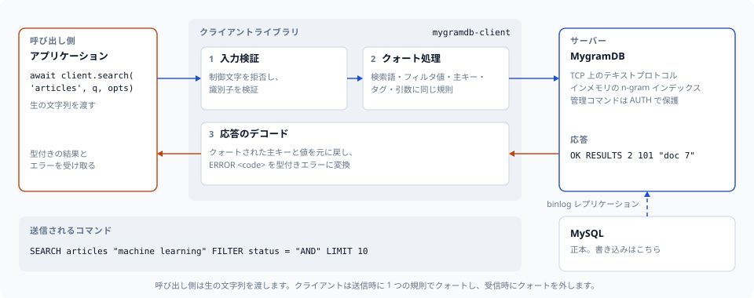

# はじめに

このガイドでは、mygramdb-client Python ライブラリの使い方を説明します。



## インストール

### GitHub からのインストール

```bash
pip install git+https://github.com/libraz/python-mygramdb-client.git
```

### rye を使用する場合

```bash
rye add mygramdb-client --git https://github.com/libraz/python-mygramdb-client.git
```

### ソースからインストール

```bash
git clone https://github.com/libraz/python-mygramdb-client.git
cd python-mygramdb-client
rye sync
```

> **Note:** PyPI への登録は将来的に予定しています。

## 必要条件

- Python 3.11 以上
- asyncio サポート

## 基本的な使い方

### MygramDB への接続

```python
import asyncio
from mygramdb_client import MygramClient, ClientConfig

async def main():
    # デフォルト設定でクライアントを作成
    client = MygramClient()

    # カスタム設定を使用する場合
    client = MygramClient(ClientConfig(
        host='localhost',
        port=11016,
        timeout=5.0,
        recv_buffer_size=65536,
        max_query_length=128
    ))

    # サーバーに接続
    await client.connect()

    # 接続状態を確認
    if client.is_connected():
        print("MygramDB に接続しました！")

    # 使い終わったら切断
    await client.disconnect()

asyncio.run(main())
```

### ドキュメントの検索

```python
from mygramdb_client import MygramClient, SearchOptions

async def search_example():
    client = MygramClient()
    await client.connect()

    # 基本的な検索
    results = await client.search('articles', 'python tutorial')
    print(f"{results.total_count} 件見つかりました")

    for result in results.results:
        print(f"  - {result.primary_key}")

    # オプション付き検索
    results = await client.search('articles', 'python', SearchOptions(
        limit=50,
        offset=0,
        and_terms=['tutorial', 'beginner'],
        not_terms=['advanced'],
        filters={'status': 'published'},
        sort_column='created_at',
        sort_desc=True
    ))

    await client.disconnect()
```

### ドキュメントのカウント

```python
from mygramdb_client import MygramClient, CountOptions

async def count_example():
    client = MygramClient()
    await client.connect()

    # 基本的なカウント
    response = await client.count('articles', 'python')
    print(f"件数: {response.count}")

    # オプション付きカウント
    response = await client.count('articles', 'python', CountOptions(
        and_terms=['tutorial'],
        not_terms=['deprecated'],
        filters={'lang': 'ja'}
    ))

    await client.disconnect()
```

### ID でドキュメントを取得

```python
async def get_example():
    client = MygramClient()
    await client.connect()

    doc = await client.get('articles', '12345')
    print(f"プライマリキー: {doc.primary_key}")
    print(f"フィールド: {doc.fields}")

    await client.disconnect()
```

### サーバー情報の取得

```python
async def info_example():
    client = MygramClient()
    await client.connect()

    # サーバー情報を取得
    info = await client.info()
    print(f"バージョン: {info.version}")
    print(f"稼働時間: {info.uptime_seconds} 秒")
    print(f"ドキュメント数: {info.doc_count}")
    print(f"テーブル: {info.tables}")

    # 設定を取得
    config = await client.get_config()
    print(config)

    await client.disconnect()
```

### レプリケーション制御

```python
async def replication_example():
    client = MygramClient()
    await client.connect()

    # レプリケーション状態を取得
    status = await client.get_replication_status()
    print(f"実行中: {status.running}")
    print(f"GTID: {status.gtid}")

    # レプリケーションを制御
    await client.stop_replication()
    await client.start_replication()

    await client.disconnect()
```

### デバッグモード

```python
async def debug_example():
    client = MygramClient()
    await client.connect()

    # デバッグモードを有効化
    await client.enable_debug()

    # デバッグ情報付きで検索
    results = await client.search('articles', 'python')

    if results.debug:
        print(f"クエリ時間: {results.debug.query_time_ms}ms")
        print(f"候補数: {results.debug.candidates}")
        print(f"最終結果: {results.debug.final}")

    # デバッグモードを無効化
    await client.disable_debug()

    await client.disconnect()
```

## 設定オプション

| オプション | 型 | デフォルト | 説明 |
|-----------|-----|----------|------|
| `host` | str | "127.0.0.1" | サーバーのホスト名、IPv4 リテラル、または IPv6 リテラル（例: `"::1"`） |
| `port` | int | 11016 | サーバーのポート |
| `socket_path` | str | "" | Unix ソケットパス。指定時は host/port より優先 |
| `timeout` | float | 5.0 | 接続・コマンド読み取りのデフォルトタイムアウト（秒） |
| `connect_timeout` | Optional[float] | None | 接続のデッドライン。未指定なら `timeout` にフォールバック |
| `command_timeout` | Optional[float] | None | レスポンス読み取りのデッドライン。未指定なら `timeout` にフォールバック |
| `recv_buffer_size` | int | 65536 | 受信バッファサイズ（バイト） |
| `max_query_length` | int | 128 | クエリ式の最大長 |
| `auto_reconnect` | bool | False | 書き込み前に切断を検出したら再接続＋再送 |
| `tcp_keepalive` | bool | True | TCP 接続で `SO_KEEPALIVE` を有効化 |
| `tcp_keepalive_idle` | int | 60 | 最初のキープアライブ探索までのアイドル秒数 |

## エラーハンドリング

```python
from mygramdb_client import (
    MygramClient,
    ConnectionError,
    TimeoutError,
    ProtocolError,
    InputValidationError,
    ServerError
)

async def error_handling_example():
    client = MygramClient()

    try:
        await client.connect()
        results = await client.search('articles', 'test')
    except ConnectionError as e:
        print(f"接続に失敗しました: {e}")
    except TimeoutError as e:
        print(f"タイムアウトしました: {e}")
    except ProtocolError as e:
        print(f"プロトコルエラー: {e}")
    except InputValidationError as e:
        print(f"入力が不正です: {e}")
    except ServerError as e:
        print(f"サーバーエラー: {e}")
    finally:
        await client.disconnect()
```

## 互換性に関する注記

`search_raw()` は式を引用符なしで送信するため、サーバーが `AND` / `OR` / `NOT` と括弧によるグループ化（AND の下にネストした OR グループを含む）を解釈できます（MygramDB 1.8 以降）。式は `convert_search_expression()` で構築してください。制御文字は送信前に拒否されるため、引用符なしの送信でもインジェクションに対して安全です。

`#` で始まる `facet()` の値は保持されます（MygramDB 1.8 以降）。FACET レスポンスの中でタブを含まない `#` 行のみがコメントとして扱われるため、カウントの前にタブを持つ正当な `#tag` 形式の値は保持されます。

サーバーの TCP リスナーがループバック限定でない場合、管理コマンドにはトークンが必要です（MygramDB 1.10 以降）。`ClientConfig.admin_token` を設定してください。設定しておけばクライアントが接続時と透過的な再接続時に `AUTH` を送信します。設定がないと管理コマンドは `AuthenticationError` で失敗します。TCP 経路はトークンを暗号化しないため、そのリスナーは信頼できるネットワーク内か、TLS を終端するプロキシの背後に置いてください。

エラーは数値コードを持ちます（MygramDB 1.10 以降）。メッセージの文字列一致ではなく `ServerError.error_code`（`ErrorCode` を参照）で分岐してください。`ServerNotReadyError` と `ServerBusyError` はリトライで解消しうる状態を表し、`RetryPolicy` は既定でこれらをリトライします。

## ワイヤープロトコルに関する注記

ワイヤーに乗るすべての文字列（検索テキスト、AND/NOT ターム、フィルタ値、`SET`/`SHOW VARIABLES LIKE`/`DUMP` 引数）は、Unicode 空白（全角スペース U+3000 やノーブレークスペース U+00A0 など）と、大文字小文字を区別しない句キーワードにもクォートを適用する、単一の共有クォート判定を通ります。詳細は[ワイヤークォート](api-reference.md#ワイヤークォート)を参照してください。

`simplify_search_expression()` は、OR や括弧付きの部分式に対して `ValueError` を送出します。クォートすると OR / グループ化の意味が失われるためです。そのような式には `convert_search_expression()` と `search_raw()` を使ってください。詳細は[検索式ガイド](search-expression.md)を参照してください。

空白を含む SEARCH 結果のプライマリキーは、クォートされたワイヤー形式からデコードされます。`ClientConfig.host` には IPv6 リテラルを指定できます。

## 次のステップ

- [API リファレンス](api-reference.md) - 完全な API ドキュメント
- [検索式](search-expression.md) - 高度な検索構文
- [高度な使い方](advanced-usage.md) - ベストプラクティスとパターン
