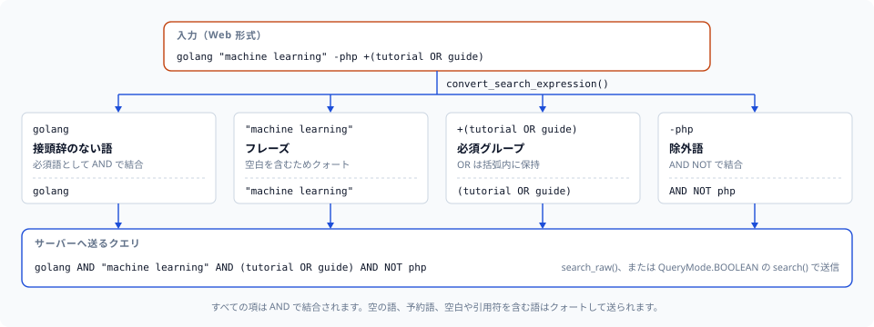

# 検索式

このガイドでは、mygramdb-client がサポートする Web スタイルの検索式構文について説明します。MygramDB 自体の C++ SDK パーサー（`src/client/search_expression.cpp`）に準拠しているため、どのクライアントで変換しても同じ意味のクエリになります。

## 概要

検索式パーサーは、Web スタイルの検索式を MygramDB のクエリ形式に変換します。これにより、Google などの検索エンジンと同様の馴染みのある検索構文を使用できます。

## 構文

| 構文 | 説明 | 例 |
|------|------|-----|
| `term` | 必須ターム、暗黙の AND（プレフィックスなしのタームはすべて必須） | `python` |
| `+term` | 必須ターム（必ず含む） | `+python` |
| `-term` | 除外ターム（含まない） | `-deprecated` |
| `"phrase"` | クォート付きフレーズ（完全一致） | `"機械学習"` |
| `OR` | 論理 OR | `python OR ruby` |
| `(expr)` | グループ化 | `+(tutorial OR guide)` |

句キーワード（`AND`、`OR`、`NOT`、`FILTER`、`SORT`、`LIMIT`、`OFFSET`、`HIGHLIGHT`、`FUZZY`、`FACET`、`ORDER`）と一致するタームは、パーサーがワイヤーに送り出す箇所で自動的にクォートされ、演算子としてではなくリテラルテキストとして一致します: `convert_search_expression('golang not')` は `golang AND "not"` になります。単語内の `+`/`-`（`COVID-19`、`e-mail`、`C++`）はそのまま扱われます。演算子として扱われるのはトークン境界にある `+`/`-` だけです。



```python
convert_search_expression('golang "machine learning" -php +(tutorial OR guide)')
# 'golang AND "machine learning" AND (tutorial OR guide) AND NOT php'
```

## 使用例

### 基本的な検索

```python
from mygramdb_client import simplify_search_expression

# 単一のターム
expr = simplify_search_expression('python')
# main_term='python', and_terms=[], not_terms=[]

# 複数のターム（暗黙の AND）— プレフィックスなしのタームはすべて必須
expr = simplify_search_expression('python tutorial')
# main_term='python', and_terms=['tutorial'], not_terms=[]
```

### 必須ターム

```python
# + で必須ターム
expr = simplify_search_expression('+python +tutorial')
# main_term='python', and_terms=['tutorial'], not_terms=[]
```

### 除外ターム

```python
# - でターム除外
expr = simplify_search_expression('python -deprecated -old')
# main_term='python', and_terms=[], not_terms=['deprecated', 'old']
```

### 組み合わせ

```python
# 必須と除外を組み合わせ（プレフィックスなしのタームも必須）
expr = simplify_search_expression('+python tutorial -deprecated')
# main_term='python', and_terms=['tutorial'], not_terms=['deprecated']
```

### フレーズ検索

```python
# クォート付きフレーズ — 事前クォートされず、プレーンテキストとして保持される
expr = simplify_search_expression('"機械学習" チュートリアル')
# main_term='機械学習', and_terms=['チュートリアル'], not_terms=[]

# 必須フレーズ
expr = simplify_search_expression('+"ディープラーニング" -入門')
# main_term='ディープラーニング', and_terms=[], not_terms=['入門']
```

`main_term`/`and_terms`/`not_terms` はプレーンテキストです。クライアントは
送信先ごとに共有のワイヤークォート判定を一度だけ適用します（例えば
`client.search()` 自身のエスケープ処理）。クライアントのメソッドを介さず
生のコマンド文字列を組み立てる場合にのみ、自分でクォートしてください。

### 複雑な式

```python
from mygramdb_client import parse_search_expression, has_complex_expression, convert_search_expression

# OR 式
expr = parse_search_expression('python OR ruby')
# has_complex_expression(expr) == True
convert_search_expression('python OR ruby')
# '(python OR ruby)'

# グループ式
expr = parse_search_expression('+(tutorial OR guide) python')
# has_complex_expression(expr) == True
convert_search_expression('+(tutorial OR guide) python')
# '(tutorial OR guide) AND python'
```

`simplify_search_expression()` には OR や括弧付きの部分式を
`main_term`/`and_terms`/`not_terms` として損失なく表現する方法がありません
— `main_term` は送信先ごとに 1 個のリテラルトークンとしてクォートされる
ため、`python OR ruby` はブール OR ではなくリテラルフレーズになってしま
います。`has_complex_expression()` が複雑と判定する式には `ValueError` を
送出します。代わりに `convert_search_expression()` と
`client.search_raw()` を使ってください（下記の
[クライアントでの使用](#クライアントでの使用) を参照）。

## クライアントでの使用

```python
from mygramdb_client import (
    MygramClient, SearchOptions, SearchRawOptions,
    simplify_search_expression, convert_search_expression,
    has_complex_expression, parse_search_expression,
)

async def search_with_expression():
    client = MygramClient()
    await client.connect()

    user_query = 'golang チュートリアル -非推奨'

    if has_complex_expression(parse_search_expression(user_query)):
        # OR / グループ化: 変換したブール式をそのまま送信
        results = await client.search_raw(
            'articles', convert_search_expression(user_query),
            SearchRawOptions(limit=100),
        )
    else:
        expr = simplify_search_expression(user_query)
        results = await client.search('articles', expr.main_term, SearchOptions(
            and_terms=expr.and_terms,
            not_terms=expr.not_terms,
            limit=100,
        ))

    print(f"{results.total_count} 件見つかりました")
    await client.disconnect()
```

## Unicode 空白のサポート

パーサーは、サーバー自身のトークナイザーと同じ空白をトークン境界として
扱います。ASCII 空白に加え、全角スペース（U+3000）やノーブレークスペース
（U+00A0）などの Unicode 空白も対象です。全角スペースで区切られた CJK
テキストは別々のタームに分割されます:

```python
expr = simplify_search_expression('日本語　検索')  # U+3000 全角スペース
# 以下と同じ: simplify_search_expression('日本語 検索')
# main_term='日本語', and_terms=['検索']
```

## エラーハンドリング

```python
from mygramdb_client import simplify_search_expression

# 空の式は ValueError を発生
try:
    expr = simplify_search_expression('')
except ValueError as e:
    print(f"エラー: {e}")  # "Search expression cannot be empty"

# 閉じていないクォートは ValueError を発生
try:
    expr = simplify_search_expression('"閉じていない')
except ValueError as e:
    print(f"エラー: {e}")  # "Unterminated quoted string at position 0"

# 除外タームのみは ValueError を発生
try:
    expr = simplify_search_expression('-spam -deprecated')
except ValueError as e:
    print(f"エラー: {e}")  # "Search expression must have at least one positive term"

# OR / グループ化は ValueError を発生 — 代わりに convert_search_expression() + search_raw() を使う
try:
    expr = simplify_search_expression('python OR ruby')
except ValueError as e:
    print(f"エラー: {e}")  # "Expression cannot be represented by the simplified client API"
```

## API リファレンス

### SearchExpression

```python
@dataclass
class SearchExpression:
    required_terms: List[str] = field(default_factory=list)  # + プレフィックス付きタームとプレフィックスなしターム（暗黙の AND）
    excluded_terms: List[str] = field(default_factory=list)  # - プレフィックス付きターム
    optional_terms: List[str] = field(default_factory=list)  # 未使用。ソース互換性のために残されている
    raw_expression: str = ""                                 # OR / グループ化された部分式のフォーマット済みテキスト
```

### SimplifiedExpression

```python
@dataclass
class SimplifiedExpression:
    main_term: str                                    # 最初の必須ターム
    and_terms: List[str] = field(default_factory=list)  # 追加の AND ターム
    not_terms: List[str] = field(default_factory=list)  # 除外ターム
```

### 関数

| 関数 | 説明 |
|------|------|
| `parse_search_expression(expr)` | SearchExpression にパース |
| `simplify_search_expression(expr)` | SimplifiedExpression にパース。OR / グループ化された式では `ValueError` を送出 |
| `convert_search_expression(expr)` | `search_raw()` 向けのブールクエリ文字列に変換 |
| `has_complex_expression(expr)` | OR/グループ化をチェック |
| `to_query_string(expr)` | SearchExpression をクエリ文字列に変換 |
